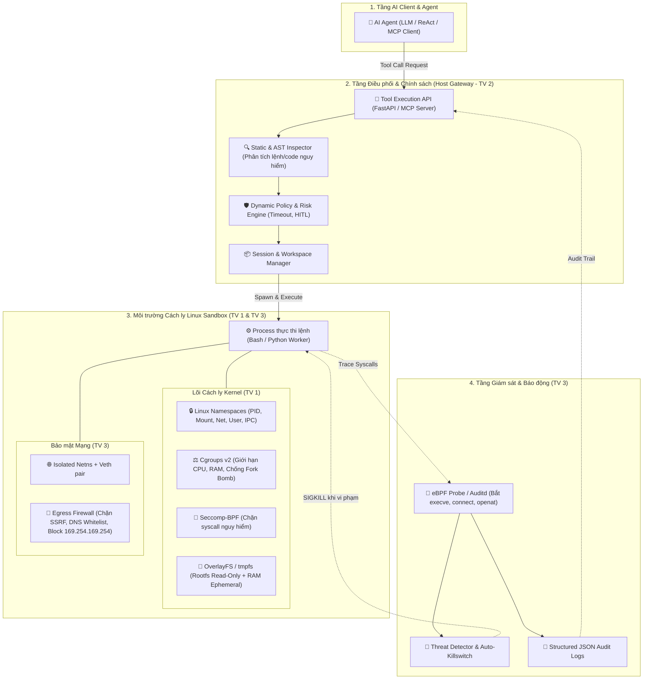

# Kế hoạch Dự án: Secure Agentic AI Tool Execution using Linux Sandbox

> **Mục tiêu**: Xây dựng môi trường Sandbox Linux an toàn, hiệu năng cao và có khả năng kiểm soát chặt chẽ (isolation, policy enforcement, network egress control, audit log) để phục vụ cho AI Agent thực thi các công cụ (Bash, Python, MCP tools) mà không gây rủi ro cho máy chủ chủ quản (Host OS).

---

## 1. Kiến trúc Tổng thể (System Architecture)

### 1.1. Sơ đồ Luồng Hoạt động (Mermaid Architecture)



---

### 1.2. Phân tầng Kiến trúc (Architecture Breakdown)

Hệ thống được thiết kế theo nguyên lý **Phòng thủ Đa tầng (Defense-in-Depth)** gồm 4 lớp bảo vệ:

1. **Lớp Kiểm soát Đầu vào (Pre-Execution Guardrails - TV 2 phụ trách)**:
   - Đón nhận yêu cầu gọi công cụ qua giao thức MCP hoặc REST API.
   - Quét cú pháp tĩnh (AST với Python, Tokenizer với Bash) nhằm phát hiện trước các lệnh phá hoại rõ ràng hoặc kỹ thuật làm rối mã (obfuscation).
   - Kiểm tra hạn mức tài nguyên (timeout, permission matrix, cơ chế Human-in-the-Loop khi có lệnh rủi ro cao).

2. **Lớp Cách ly Nhân Hệ điều hành (Kernel-level Isolation - TV 1 phụ trách)**:
   - Dùng **Linux Namespaces** để tạo không gian tiến trình, định danh người dùng và filesystem riêng biệt.
   - Dùng **Cgroups v2** siết chặt ngưỡng sử dụng tài nguyên (RAM tối đa, CPU quota, số lượng PID tối đa để chống Fork Bomb).
   - Dùng **Seccomp-BPF** triệt tiêu hơn 60% syscall không cần thiết, đặc biệt là `ptrace`, `bpf`, `mount`, `reboot`.
   - Dùng **OverlayFS** với phân vùng gốc Read-Only và bộ nhớ tạm `tmpfs`, tự động xóa sạch dấu vết sau phiên chạy.

3. **Lớp Cách ly Mạng (Network Egress Control - TV 3 phụ trách)**:
   - Mặc định chạy chế độ không mạng (`Offline/Air-gapped`).
   - Khi cần kết nối: Đi qua Network Namespace riêng và lọc gói bằng `nftables`/`iptables`.
   - Ngăn chặn hoàn toàn tấn công SSRF (cấm dải IP nội bộ và AWS/GCP Metadata `169.254.169.254`), chỉ mở các domain cần thiết qua DNS Proxy.

4. **Lớp Giám sát & Báo động Thời gian thực (Runtime Observability - TV 3 phụ trách)**:
   - Chương trình **eBPF** lắng nghe trực tiếp từ kernel các hành vi thực thi (`execve`), mở tệp (`openat`), và mở kết nối mạng (`connect`).
   - Cơ chế Kill-switch tự động hủy phiên ngay khi phát hiện hành vi cố ý vượt rào (sandbox breakout).

---

## 2. Phân chia Vai trò & Trách nhiệm (Team Responsibilities)

### 👤 Thành viên 1: Core Sandbox & Linux OS Isolation Engineer
- **Lĩnh vực cốt lõi**: Linux Kernel Primitives, Container Internals, Filesystem Isolation.
- **Nhiệm vụ chính**:
  - Triển khai Core Sandbox Engine (dựa trên Bubblewrap `bwrap` hoặc gVisor `runsc`).
  - Cấu hình trọn bộ Linux Namespaces (Mount, PID, Network, IPC, UTS, User mapping unprivileged).
  - Cấu hình Cgroups v2: Đặt quota CPU, giới hạn Memory (`memory.max`), chống fork bomb (`pids.max`).
  - Xây dựng OverlayFS: Rootfs Read-Only tối giản, thư mục làm việc ghi vào `tmpfs` (tự hủy khi thoát).
  - Soạn thảo Seccomp-BPF filters chặn các syscall nguy hiểm.
- **Sản phẩm bàn giao**:
  - Module nhị phân/CLI `sandbox-runner` thực thi lệnh trong môi trường cô lập.
  - Bộ cấu hình Seccomp profile và Cgroups rules.
  - Kết quả đo lường độ trễ khởi động (Cold start < 50ms, Warm start < 10ms).

---

### 👤 Thành viên 2: Agent Orchestration, Policy Engine & Tool Gateway
- **Lĩnh vực cốt lõi**: API Gateway, AST Parsing, MCP Standard, Session Lifecycle.
- **Nhiệm vụ chính**:
  - Xây dựng API Gateway chuẩn **Model Context Protocol (MCP)** và REST API (FastAPI) để giao tiếp với AI Agent.
  - Xây dựng Tool Runners: Hỗ trợ chạy Bash script, Python code, đọc/ghi file trong phạm vi cho phép.
  - Phát triển bộ phân tích tĩnh cú pháp:
    - *Python*: Duyệt cây AST phát hiện import nguy hiểm (`os`, `subprocess`, `socket`, `ctypes`).
    - *Bash*: Phân tích cú pháp shell (shlex/bashlex), phát hiện chuỗi mã hóa base64/hex hoặc subshell bất thường.
  - Quản lý vòng đời phiên: Quản lý session stateful/stateless, dọn dẹp workspace rác tự động.
  - Cơ chế Human-in-the-Loop (HITL) xác nhận hành động nguy hiểm.
- **Sản phẩm bàn giao**:
  - Tool Execution Service (API MCP + REST) với tài liệu OpenAPI.
  - Module `PolicyEngine` và `CommandAnalyzer` kèm bộ unit test.
  - Agent Demo (LangChain / LlamaIndex / Python Agent) minh họa giải quyết bài toán qua Sandbox an toàn.

---

### 👤 Thành viên 3: Network Security, eBPF Auditing & Security Red-Teaming
- **Lĩnh vực cốt lõi**: Network Namespaces, Egress Filtering, eBPF/Auditd, Pentest & Red Teaming.
- **Nhiệm vụ chính**:
  - Thiết kế cấu trúc mạng: Network Namespace kết hợp `veth pair` và host bridge.
  - Triển khai Firewall Egress (nftables): Chặn truy cập IP nội bộ (Private LAN), chặn Cloud Metadata Service (`169.254.169.254`), tích hợp DNS allowlist.
  - Triển khai eBPF / Auditd Telemetry: Giám sát thời gian thực các syscall `sys_enter_execve`, `sys_enter_connect`, `sys_enter_openat`.
  - Cơ chế cảnh báo & Killswitch: Tự động gửi `SIGKILL` khi phát hiện hành vi quét cổng hoặc đào tẩu.
  - Xây dựng bộ công cụ Red Teaming: Kiểm thử container escape, bypass AST, fork bomb, prompt injection payload.
- **Sản phẩm bàn giao**:
  - Network Controller script (cấu hình netns, veth và rule iptables/nftables).
  - eBPF Telemetry Collector xuất log JSON có cấu trúc.
  - Test-suite Red Teaming (`test_exploits/`) và Báo cáo Đánh giá Bảo mật (Security Audit Report).

---

## 3. Kế hoạch Triển khai theo Giai đoạn (Timeline / Milestones)

```mermaid
gantt
    title Lộ trình 8 Tuần Dự án Secure Sandbox
    dateFormat  YYYY-MM-DD
    section Giai đoạn 1: Kiến trúc & PoC
    Nghiên cứu Threat Model & Thử nghiệm bwrap/gVisor  :done, 2026-11-03, 7d
    Thiết kế chuẩn MCP & Mock Tool API                 :done, 2026-11-10, 7d
    section Giai đoạn 2: Phát triển Cốt lõi
    Kernel Isolation: Namespaces, Cgroups, Seccomp     :active, 2026-11-17, 14d
    API Gateway, AST Analyzer & Policy Engine          :active, 2026-11-17, 14d
    Network Namespace & Egress Firewall Rules          :active, 2026-11-17, 14d
    section Giai đoạn 3: Giám sát & Tích hợp
    eBPF / Auditd Telemetry & Killswitch               :2026-12-01, 10d
    Tích hợp AI Agent Framework (LangChain/MCP)        :2026-12-01, 10d
    section Giai đoạn 4: Red Teaming & Hoàn thiện
    Red Teaming Pentest (Escape, DoS, SSRF)            :2026-12-11, 10d
    Tối ưu hiệu năng, hoàn thiện Báo cáo & Tài liệu    :2026-12-21, 8d
```

---

## 4. Chuẩn Giao diện Kết nối giữa 3 Thành viên (Interface Contracts)

Để 3 thành viên làm việc song song mà không bị phụ thuộc mã nguồn, các điểm giao diện được thỏa thuận như sau:

### 🔹 Hợp đồng 1: Execution Interface (Thành viên 1 ⟷ Thành viên 2)
- **Thành viên 1** đóng gói lệnh chạy thành CLI hoặc Python/C binding:
  ```bash
  sandbox-runner --mem 256M --cpu 0.5 --net [none|filtered] --timeout 15s --rootfs /path/to/rootfs --cmd "bash -c '...'"
  ```
- **Kết quả trả về định dạng JSON**:
  ```json
  {
    "stdout": "output data...",
    "stderr": "error data...",
    "exit_code": 0,
    "duration_ms": 142,
    "resource_usage": {
      "memory_peak_mb": 42.5,
      "cpu_time_ms": 85
    }
  }
  ```
- **Thành viên 2** chỉ cần gọi hàm này từ API Gateway mà không cần quan tâm chi tiết cấu hình namespace hay cgroups.

---

### 🔹 Hợp đồng 2: Network & Cgroup Hook (Thành viên 1 ⟷ Thành viên 3)
- Khi **Thành viên 1** khởi tạo sandbox, runner sẽ sinh ra:
  - `PID` của init process trong sandbox.
  - Đường dẫn namespace mạng: `/var/run/netns/sandbox_<id>`.
  - Cgroup path: `/sys/fs/cgroup/sandbox_<id>`.
- **Thành viên 3** cung cấp hook script `setup_netns.sh <netns_id>` để gắn `veth pair`, áp dụng nftables rules và đăng ký cgroup ID vào eBPF probe.

---

### 🔹 Hợp đồng 3: Audit Log & Alert Interface (Thành viên 2 ⟷ Thành viên 3)
- **Thành viên 3** thu thập sự kiện qua eBPF và ghi ra Unix Domain Socket hoặc tệp log JSONL:
  ```json
  {
    "timestamp": "2026-11-17T10:30:15.123Z",
    "sandbox_id": "sbx-a8f19",
    "syscall": "sys_enter_connect",
    "target_ip": "169.254.169.254",
    "target_port": 80,
    "action": "BLOCKED_BY_FIREWALL",
    "alert_level": "CRITICAL"
  }
  ```
- **Thành viên 2** tiêu thụ stream log này để cập nhật trạng thái session hoặc cảnh báo tới người dùng / dashboard.

---

### 🔹 Hợp đồng 4: Phối hợp Red Team & Hardening (Thành viên 3 ⟷ Thành viên 1, 2)
- **Thành viên 3** thực hiện các kịch bản tấn công (escape, bypass, DoS) và lập báo cáo lỗ hổng (Vulnerability Report).
- **Thành viên 1** tiếp nhận báo cáo để vá ở tầng Kernel/Seccomp/Cgroups.
- **Thành viên 2** tiếp nhận báo cáo để vá ở tầng AST/Command Inspector/Policy.

---

## 5. Tiêu chuẩn Nghiệm thu Kỹ thuật (Acceptance Criteria)

| Hạng mục | Tiêu chí Đạt (Pass Criteria) | Thành viên Phụ trách |
| :--- | :--- | :--- |
| **Cách ly Hệ thống (Escape Defense)** | Ngăn chặn 100% các hành vi đọc file host (`/etc/shadow`, ssh keys), không thể can thiệp tiến trình bên ngoài sandbox. | Thành viên 1 |
| **Chống Phá hoại Tài nguyên (DoS)** | Fork bomb hoặc cấp phát RAM vượt giới hạn bị Cgroup triệt tiêu; CPU/RAM của host không bị ảnh hưởng quá 5%. | Thành viên 1 |
| **Bảo mật Mạng (Anti-SSRF & Leak)** | 100% request đến IP nội bộ (`10.x`, `192.168.x`, `127.0.0.1`) và Cloud Metadata (`169.254.169.254`) bị drop ngay lập tức. | Thành viên 3 |
| **Độ trễ Thực thi (Performance)** | Thời gian khởi tạo sandbox (Cold Start) **< 100ms** (với Bubblewrap đạt mục tiêu < 30ms). Overhead eBPF **< 3% CPU**. | Thành viên 1 & 3 |
| **Giao thức & Tích hợp (Agent Ready)** | API hỗ trợ chuẩn **Model Context Protocol (MCP)**, tích hợp mượt mà với ít nhất 1 AI Agent thực tế. | Thành viên 2 |
| **Giám sát & Minh bạch (Auditability)** | 100% các câu lệnh và syscall quan trọng (`execve`, `connect`, `openat`) đều được ghi log JSON kèm ID định danh. | Thành viên 2 & 3 |
